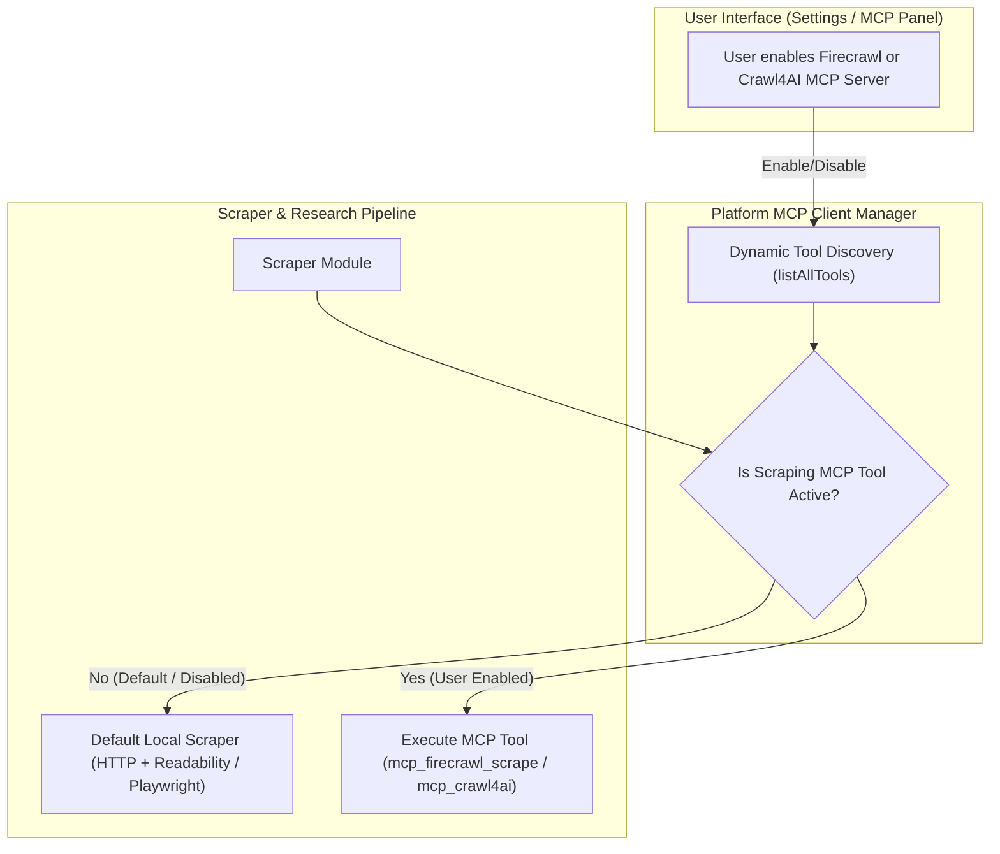

# Advanced Web Scraper Evaluation: Crawl4AI vs. Firecrawl

## 1. Overview and Objectives

The current web extraction pipeline in the application relies on a two-tier mechanism:
- **Tier 1 (Fast Fetch)**: Direct HTTP fetching combined with standard Readability extraction and selector fallbacks.
- **Tier 2 (Headless Browser)**: An on-demand Chromium instance managed via Playwright, running within the application process.

While effective for standard articles, modern web pages frequently present challenges such as heavy client-side JavaScript rendering (SPAs), aggressive bot-detection systems (Cloudflare, PerimeterX, Datadome), complex layouts, and noisy navigational structures.

This specification evaluates the feasibility and architectural design for integrating two advanced, AI-centric scraping engines:
1. **Crawl4AI**: An open-source, high-performance web crawler and LLM content extractor.
2. **Firecrawl**: An AI-native web scraping, crawling, and structured extraction engine available as both a managed cloud service and self-hosted solution.

---

## 2. Technical Comparison

| Dimension | Crawl4AI | Firecrawl |
| :--- | :--- | :--- |
| **Primary Language** | Python (AsyncIO, Playwright) | TypeScript / Node.js |
| **Native Integration** | External service via HTTP / REST API | Native Node.js SDK and REST API |
| **Deployment Models** | Self-hosted (Docker container) | Managed Cloud API or Self-hosted (Docker Compose) |
| **LLM Output Quality** | Excellent (heuristics, BM25, fit-markdown) | Excellent (clean Markdown, noise stripping) |
| **Multi-page Crawling** | Yes (batch crawling via API) | Yes (first-class `crawl` and `map` operations) |
| **Structured Extraction** | Yes (schema-based via LLM or heuristics) | Yes (JSON Schema / Zod extraction via LLM) |
| **Anti-bot Bypass** | Playwright stealth, user-provided proxies | Automated proxy rotation & bypass in Cloud mode |
| **Resource Footprint** | Additional container (~1-2 GB RAM for Python + Chromium) | Zero extra RAM (Cloud mode) or multi-container (Self-hosted) |
| **Licensing & Cost** | 100% Open Source (Apache 2.0) | Open Source (AGPL-3.0) / Freemium Managed Cloud |

---

## 3. Deep-Dive Feasibility Analysis

### A. Firecrawl Feasibility

1. **Ecosystem Alignment**:
   - The application is built on Next.js and TypeScript.
   - Firecrawl provides an official client library for JavaScript/TypeScript, allowing direct, typed consumption without child processes or custom HTTP adapter layers.

2. **Managed Cloud Operation**:
   - By supplying an API key, extraction requests can be offloaded to Firecrawl Cloud.
   - Eliminates headless browser memory pressure on the application server.
   - Solves IP-blocking and anti-bot challenges via automated managed proxy networks.

3. **Crawl and Map Capabilities for Deep Research**:
   - Deep Research workflows can utilize recursive domain crawling and sitemap mapping directly, eliminating custom link-graph traversal logic.

4. **Self-Hosted Feasibility**:
   - For environments requiring full data sovereignty, Firecrawl provides a self-hosted Docker Compose stack. However, the self-hosted stack requires supplementary backing services (such as Redis and workers).

### B. Crawl4AI Feasibility

1. **Ecosystem Divergence**:
   - Crawl4AI is purely Python-based. Direct in-process execution inside the Next.js runtime is not viable.
   - Integration requires running Crawl4AI as an independent microservice exposing its HTTP REST API.

2. **Operational Architecture**:
   - Crawl4AI publishes official Docker container images containing the Python runtime and Playwright dependencies.
   - The application communicates with Crawl4AI over local network HTTP calls.

3. **Key Advantages**:
   - Fully open-source with no tier limits.
   - Advanced algorithmic markdown generation (BM25 pruning, content clustering) that produces concise text without consuming third-party extraction credits.

4. **Operational Challenges**:
   - Requires hosting and maintaining an additional persistent container.
   - Memory allocation on resource-constrained servers increases significantly.

---

## 4. Proposed Architecture: Pluggable Scraper Engine

To maximize flexibility and avoid vendor lock-in, the recommended approach is a **Pluggable Scraper Provider** architecture. The existing scraping interface remains intact, while delegating extraction to the active provider based on environment configuration.

### Provider Interface Design

```typescript
export interface ScraperEngineProvider {
  name: 'local' | 'firecrawl' | 'crawl4ai';
  isAvailable(): boolean;
  scrape(url: string, options?: ProviderScrapeOptions): Promise<ScrapeResult>;
  crawl?(url: string, options?: ProviderCrawlOptions): Promise<CrawlResult>;
  map?(url: string): Promise<string[]>;
}
```

### Provider Implementation Strategy

1. **LocalProvider (Default / Baseline)**:
   - Preserves current two-tier architecture (Fast HTTP Fetch with Readability + on-demand Playwright).
   - Zero external dependencies; operates fully out-of-the-box.

2. **FirecrawlProvider**:
   - Activated when a Firecrawl API key or custom API endpoint is defined in environment variables.
   - Directly transforms pages into LLM-optimized Markdown.
   - Can optionally provide recursive domain crawl results to Deep Research.

3. **Crawl4AIProvider**:
   - Activated when a Crawl4AI service endpoint is configured.
   - Issues asynchronous requests to the Crawl4AI REST container and converts the JSON response into the standard scraping format.

### Fallback Hierarchy

```
Target URL
    │
    ▼
[SSRF Security Filter] ──(Blocked)──> Return Security Error
    │
    ▼
Is Enhanced Provider Configured?
    ├── Yes: Firecrawl ──(Success)──> Return Clean Markdown
    │         └── (Failure) ──> Fallback to Local Engine
    ├── Yes: Crawl4AI  ──(Success)──> Return Clean Markdown
    │         └── (Failure) ──> Fallback to Local Engine
    └── No: Proceed with Local Two-Tier Engine
              ├── Tier 1: Fast HTTP + Readability
              └── Tier 2: Local Playwright Chromium
```

---

## 5. Configuration and Environment Model

The system can be configured via environment settings:

- `SCRAPER_PROVIDER`: Provider selection strategy (`auto`, `local`, `firecrawl`, `crawl4ai`). Default: `auto`.
- `FIRECRAWL_API_KEY`: API key for managed Firecrawl Cloud.
- `FIRECRAWL_BASE_URL`: Optional custom URL for self-hosted Firecrawl installations.
- `CRAWL4AI_API_URL`: Optional URL pointing to the Crawl4AI REST container.

---

## 6. Dynamic User-Controlled Selection via MCP (Model Context Protocol)

A highly flexible and native approach is to leverage the application's existing Model Context Protocol (MCP) subsystem. This allows users to enable, configure, and switch scraping engines directly in the user interface on demand.

### Architecture Overview



### Key Integration Points:

1. **Pre-configured MCP Server Presets**:
   - Both **Firecrawl** and **Crawl4AI** provide standardized MCP servers:
     - **Firecrawl MCP**: Available as an official CLI package executable via `npx -y firecrawl-mcp` with an API key, exposing `firecrawl_scrape`, `firecrawl_crawl`, and `firecrawl_map`.
     - **Crawl4AI MCP**: Available via an SSE HTTP endpoint or Docker container exposing asynchronous scraping and markdown extraction tools.
   - The user settings panel can present pre-configured one-click templates for these servers, requiring only API credentials or connection URLs.

2. **On-Demand User Activation**:
   - The user toggles the server `enabled` state in the MCP settings panel.
   - When active, the dynamic tool discovery registry registers the corresponding tools for the research agent.

3. **Core Scraper Delegation & Auto-Routing**:
   - In addition to exposing the tool directly to the agent LLM, the core scraping module queries active MCP tools.
   - If an approved scraping MCP tool is detected, background content extraction (such as search result harvesting in Quality Mode) can delegate directly to the activated MCP tool.
   - If disabled or if invocation fails, the system automatically falls back to the local built-in Playwright/Readability engine.

4. **Benefits of MCP-Driven Integration**:
   - **Zero Vendor Lock-in**: The core application codebase remains decoupled from external scraping libraries.
   - **User Choice**: Individual users or administrators control which engine handles their web requests in real time.
   - **Hot Swapping**: Toggling a scraper does not require application rebuilds, environment variable updates, or container restarts.

---

## 7. Container Orchestration & Docker Compose Profiles

To avoid bloating the default single-container deployment while making local containerized scrapers immediately accessible, the Docker Compose architecture utilizes **Compose Profiles**:

1. **Default Mode (`docker compose up`)**:
   - Runs exclusively the main application container.
   - Ideal for standard setups using either the local built-in engine or Firecrawl Cloud via `stdio` (`npx -y firecrawl-mcp`).
   - Keeps memory consumption minimal (~500 MB RAM).

2. **Scraper Profile (`docker compose --profile crawl4ai up -d`)**:
   - Spins up the official `crawl4ai` container alongside the application on the same internal bridge network.
   - The application can communicate directly with `http://crawl4ai:11235/mcp` without exposing host ports or configuring custom networking.
   - The MCP settings preset connects to the container with one click.

---

## 8. Recommendations and Next Steps

1. **Primary Recommendation**:
   - **Adopt Firecrawl as the primary advanced provider**, supporting both direct configuration and dynamic activation via the MCP interface.
   - Leverage the official Firecrawl MCP server for instant one-click enablement.

2. **Secondary / Self-Hosted Alternative**:
   - **Support Crawl4AI as a containerized MCP service** (SSE transport) for users requiring air-gapped or zero-cost scraping.

3. **Implementation Roadmap**:
   - Step 1: Add pre-configured templates for Firecrawl and Crawl4AI in the MCP settings interface.
   - Step 2: Implement dynamic auto-routing in the scraping module to prefer active MCP scraping tools.
   - Step 3: Implement graceful fallback to the local built-in engine if the external MCP server encounters latency or errors.
   - Step 4: Include optional Docker Compose profiles for one-command containerized scraper execution.
   - Step 5: Visual indicators and telemetry across research steps, citations, and message metadata.

---

## 9. Search & Scraping Telemetry and Real-Time Visual Indicators

To give users full transparency and confidence that their enabled MCP scraper (Firecrawl or Crawl4AI) is actively utilized during research, the system surfaces real-time badges across three distinct interface layers:

### A. Live Research Steps (`AssistantSteps`)
- **Reading Step Header**: Dynamically reflects the extraction provider (e.g., `Reading sources (4) • Firecrawl (MCP)` or `Reading sources (4) • Crawl4AI (MCP)`).
- **Per-Source Indicator Badges**: Each source pill in the reading list displays a dedicated engine badge (e.g., `🔥 Firecrawl` or `⚡ Crawl4AI`), confirming which scraper harvested the document.
- **Graceful Fallback Alert**: If an active MCP server encounters an authorization issue or network timeout, a warning badge appears showing that the pipeline smoothly fell back to the built-in parser without interrupting the user's research flow.

### B. Source Citations (`MessageSources`)
- Every citation card in both the compact preview grid and the expanded modal displays the engine badge alongside the domain and source index.
- Search engine providers (e.g., Google, Brave, DuckDuckGo) from SearXNG are also displayed on cards where raw search snippets were utilized.

### C. Response Telemetry Bar (`MessageBox`)
- Located in the message metadata row alongside Model, Latency, and Token usage.
- Shows the active scraper engine used for extracting the underlying facts (e.g., `🔥 Firecrawl (MCP)`, `⚡ Crawl4AI (MCP)`, or `🌐 Built-in`).
- Displays the search engines queried by the search provider.


