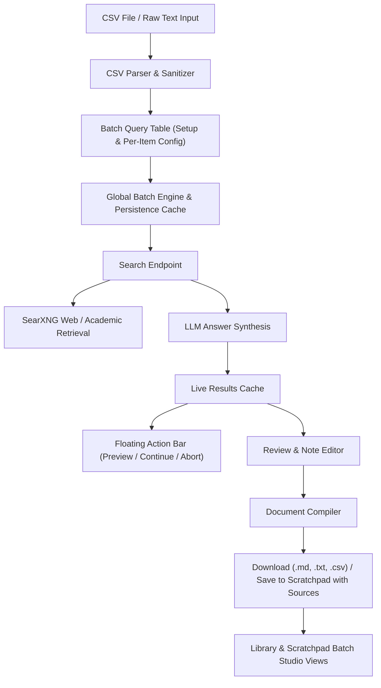

# Batch Search & CSV Query Processing Architecture

## 1. Overview and Purpose

The **Batch Search** module introduces an asynchronous, high-throughput research workflow designed for bulk conceptual exploration and systematic question answering. Unlike single interactive chat queries, Batch Search allows users to supply a dataset of questions or concepts via standard CSV formatting (`nr;pytanie / pojęcia`), configure fine-grained search modes per query, sequentially execute web and academic retrieval, inspect and edit synthesized research notes, and compile a structured export document.

---

## 2. Key Capabilities & Workflow

1. **Flexible CSV Ingestion**:
   - Accepts CSV files or raw text input adhering to `nr;pytanie / pojęcia`.
   - Automatic delimiter detection (semicolon `;`, comma `,`, or tab `\t`).
   - Intelligent header row detection and handling of quotes and numbering.
   - Built-in CSV template download and sample dataset loader for instant demonstration.

2. **Per-Query & Bulk Customization**:
   - Each query item can be customized individually before execution:
     - **Sources Selection**: Multiselect between Web, Academic, and Discussions sources.
     - **Optimization Mode**: Choice between Speed (fast synthesis), Balanced, and Quality (thorough analysis).
     - **Model Assignment**: Override specific LLM providers and models per query item.
     - **Query Item Editing**: Rename, edit, renumber, add, or remove items dynamically.
   - **Bulk Actions & Mass Model Assignment**:
     - Global **Model for All** selector: One-click assignment of any configured provider/model across all imported queries without having to adjust rows manually.
     - Batch apply sources (Web, Academic, Discussions) or optimization modes (Speed, Quality) to all queries simultaneously.

3. **Sequential Pipeline & Background Resilience**:
   - Executes queries sequentially one after another, keeping real-time progress indicators.
   - **Global Background Persistence**: State and execution loop operate at the root application context with automatic local session caching. Users can close the modal, navigate across the app, or accidentally exit without losing execution progress, loaded queries, or generated notes.
   - Per-item status tracking: Pending, Searching, Completed, and Error.
   - Full playback controls: Pause, Resume, Stop, and Retry Failed items.
   - Dedicated "Continue Search" action automatically processes remaining uncompleted or interrupted items.
   - **Search Regeneration (Regenerate / Re-run)**:
     - Global batch regeneration button appears when all or part of queries are complete, allowing full or selected re-runs.
     - Per-row regeneration button in the Queue table actions to re-query specific items.
     - Individual note card regeneration button in the Results & Review tab for immediate re-synthesis without re-importing the dataset.
   - Real-time telemetry displaying duration and source discovery counts.

4. **Floating Action Bar & Quick Controls**:
   - When a batch process is active or contains reviewable items while the modal is closed, a floating widget appears at the bottom-right corner of the interface.
   - Displays real-time progress (`completed / total`), percentage, and active query title.
   - Quick Action Buttons:
     - **Preview**: One-click opening of the review tab to inspect notes immediately.
     - **Continue / Resume**: Resumes execution if interrupted or paused.
     - **Pause**: Suspends batch execution cleanly after the active query.
     - **Stop / Abort**: Immediately aborts ongoing searches.

5. **Interactive Review & Note Editing**:
   - Users can inspect synthesized findings before final document compilation.
   - Dual-mode card interface: Rendered Markdown preview and live note editor.
   - Inline source citation links with external navigation.
   - Note-level regeneration button for refreshing individual concepts.
   - Embedded status banner with direct "Continue remaining queries" button when viewing partially completed batches.

6. **Compiled Document Export & Scratchpad Integration**:
   - Automatically builds a compiled, structured document adhering to:
     ```markdown
     # Pytanie / pojęcie [nr]

     [treść notatki]

     ---
     ```
   - Configurable title format (`Question [No.]` or `[No.] Question`).
   - Optional reference links and source bibliography footer.
   - Multi-format export: Markdown (`.md`), Plain Text (`.txt`), and CSV (`.csv`).
   - One-click copy to system clipboard.
   - **Seamless Scratchpad Integration & Source Retention**:
     - Automatically aggregates, normalizes, and deduplicates all discovered research sources across all batch questions.
     - Passes full source metadata directly to Scratchpad, ensuring complete source citation cards, favicons, and links appear in the Scratchpad canvas.
     - Tagged with dedicated `batch` note type and question count metadata.
   - High-volume batch optimizations: Queue and results tables support pagination (10, 25, 50, 100, All) and row-level memoization to eliminate render lag across 100+ queries, while Scratchpad canvas receives section-aware pagination and lifecycle-managed export to prevent browser freezing.

---

## 3. Component Architecture & Data Flow



---

## 4. UI Entry Points & Library Integration

1. **Unified Search & Input Panels**:
   - Entry point trigger badge positioned alongside Optimization controls in the primary search input panels.
   - Clicking opens the responsive Batch Search Studio modal overlay.

2. **Dedicated Workspace Page**:
   - Dedicated full-page route accessible directly via navigation rail and URL.

3. **Dedicated Batch Search Tab in Library**:
   - The Library features a dedicated "Batch Search" tab alongside All Chats and Schedules.
   - Displays real-time active session banner with progress indicators, status, and quick link to return to the active studio session.
   - Lists all saved Batch Research documents from Scratchpad with direct navigation, question counts, and discovered sources count.
   - Quick action to launch new batch research workflows.

4. **Scratchpad Batch Category**:
   - Scratchpad workspace contains dedicated category tabs (`All`, `Notes`, `Batch Research`, `Presentations`).
   - Batch notes are highlighted with specialized cyan badges, query counts, and filtered views.

5. **Floating Quick-Access Bar**:
   - Persists unobtrusively at the bottom corner for immediate preview, continuation, and stopping from anywhere in the app.

6. **Global Event System**:
   - Dispatches and listens to standard window events for seamless modal invocation from any view.

---

## 5. Localization & Internationalization

All user interface labels, status badges, column headers, toasts, and guidance notes are fully internationalized across all 12 supported languages (`en`, `pl`, `de`, `es`, `fr`, `it`, `pt`, `ru`, `uk`, `zh`, `ja`, `ko`).
