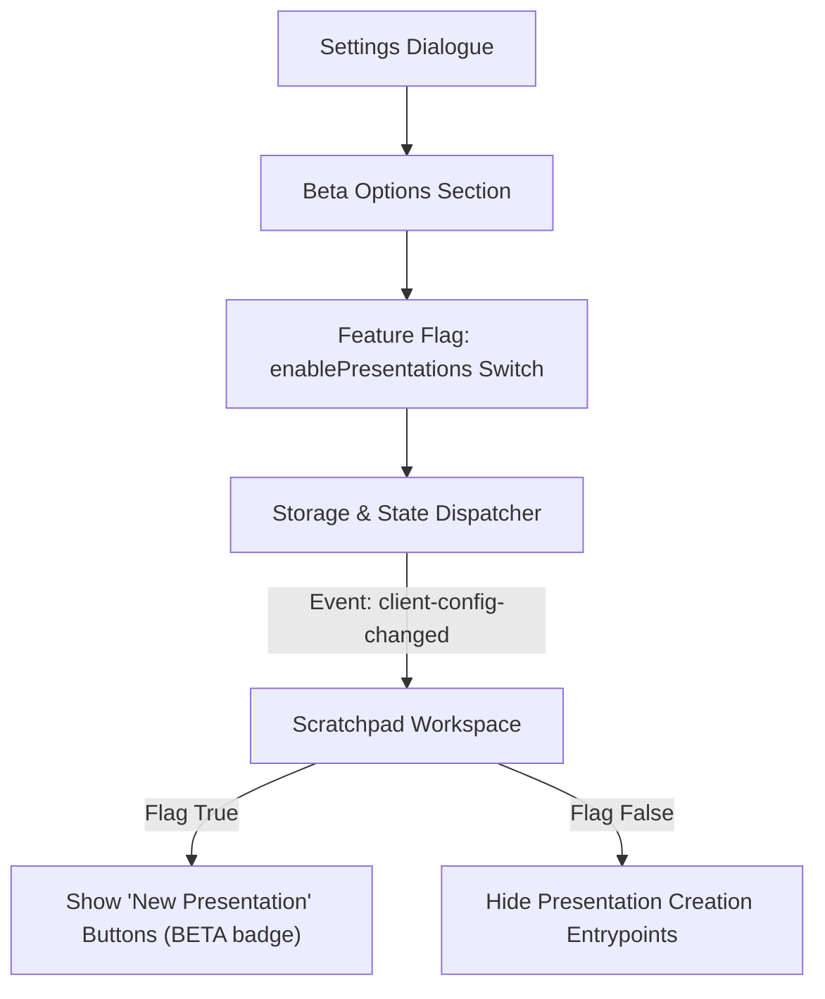

# Beta Options & Experimental Features Architecture

## 1. Overview and Purpose

The **Beta Options** system provides an isolated, user-configurable management panel within Settings for experimental laboratory features. It enables early access to cutting-edge features while ensuring core platform stability by allowing users to toggle new capabilities on or off as desired.

The initial beta feature managed under this panel is the **AI Presentations** generator.

---

## 2. Key Capabilities

1. **Dedicated Settings Tab**:
   - A dedicated **Beta Options** section in the main Settings dialogue.
   - Identified by an experimental laboratory icon (`FlaskConical`) and distinct visual styling.
   - Informative laboratory banner clarifying that features in this section are in active testing and continuous development.

2. **Feature Flags**:
   - **AI Presentations (`enablePresentations`)**:
     - Controls availability of multimedia slide deck creation, deep research workflows, and presentation authoring tools.
     - When enabled, presentation creation entry points appear in the Scratchpad workspace with distinct `BETA` visual indicators.
     - When disabled, presentation creation buttons are cleanly removed, preserving a streamlined notes-only environment.

3. **Reactivity & Instant Synchronization**:
   - Toggling flags automatically dispatches the `client-config-changed` event.
   - Workspace views dynamically re-evaluate feature flags without requiring a full page reload.

---

## 3. Architecture and Data Flow

---

## 4. Configuration Schema

- **Config Manager**:
  - `beta.enablePresentations`: boolean flag with validation.
  - Initialized with default disabled state (`false`) across migrations and new environments.
  - Whitelisted in allowed configuration keys.
- **Client Registry**:
  - `getEnablePresentations()`: client-side accessor querying persistent storage with fallback to active defaults.

---

## 5. Multi-language Localization

All textual labels, section names, badges, and descriptions for Beta Options are localized across all 12 supported languages (`en`, `pl`, `de`, `es`, `fr`, `it`, `pt`, `ru`, `uk`, `zh`, `ja`, `ko`).
