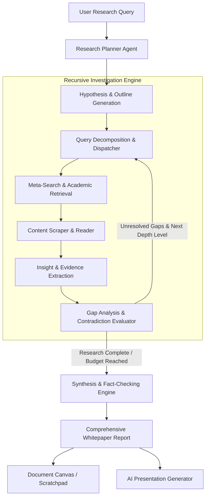

# Deep Research & Recursive Autonomous Exploration Architecture

## 1. Overview and Purpose

The **Deep Research** system introduces an autonomous, multi-stage recursive investigation engine designed for exhaustive problem-solving, open-ended scientific inquiries, market analysis, and comprehensive literature reviews.

While existing modes (Speed, Balanced, Quality) operate in single-pass retrieval loops, Deep Research functions as an iterative cognitive agent. It deconstructs complex queries into structured research hypotheses, performs multi-hop recursive web and academic retrieval, cross-examines conflicting sources, and synthesizes exhaustive, publication-grade whitepapers directly integrated with the document canvas and presentation generator.

---

## 2. Key Capabilities & Workflow

1. **Autonomous Hypothesis & Plan Formulation**:
   - Analyzes open-ended research topics and formulates a structured research plan.
   - Generates primary and secondary investigation vectors across multiple domain areas.
   - Transparently presents the research outline to the user with real-time status indicators.

2. **Recursive Multi-Hop Exploration**:
   - Executes search queries through meta-search engines and academic databases.
   - Recursively follows up on discovered leads: when a primary search reveals new entities, unexplained contradictions, or missing details, the engine dynamically constructs follow-up queries.
   - Supports configurable recursion depth limits to balance thoroughness with execution speed.

3. **Source Verification & Contradiction Resolution**:
   - Evaluates source authority, publication dates, and cross-source consensus.
   - Explicitly flags conflicting viewpoints or differing data points between sources.
   - Maintains an immutable audit trail of citations, ensuring every asserted claim links directly to its origin.

4. **Exhaustive Whitepaper Synthesis**:
   - Generates rich, multi-section reports featuring executive summaries, methodology overviews, comparative analysis, data tables, and future outlooks.
   - Automatically structures citations with IEEE/APA-compliant reference formatting.

5. **Direct Canvas & Presentation Hand-off**:
   - **Scratchpad Integration**: Instantly compiles research findings into a multi-page document within the notes workspace with version history and pagination.
   - **AI Presentation Integration**: Passes distilled research findings, bullet points, and thematic sections directly to the presentation planning pipeline for automated slide generation.

6. **Real-time Live Progress Telemetry**:
   - Step-by-step progress visualizer tracking active hypotheses, explored sources, scraped pages, and synthesized insights.
   - Interactive playback controls: Pause, Resume, Abort, and Deepen Specific Topic.

---

## 3. Architecture and Data Flow

---

## 4. Agent Roles & Orchestration

1. **Planner Agent**:
   - Deconstructs the research query into logical sub-topics.
   - Identifies whether academic, web, or discussion sources are most relevant for each sub-topic.
   - Assigns priority weights to each research branch.

2. **Exploration & Scraping Agent**:
   - Executes targeted queries against search engines.
   - Extracts semantic passages from web documents while stripping navigation elements and ads.
   - Scores extracted snippets against the active hypothesis.

3. **Gap Analysis & Refinement Agent**:
   - Analyzes findings collected in the current iteration.
   - Determines whether sufficient evidence exists to answer the sub-topic or if secondary investigation is needed.
   - Generates refined follow-up queries targeting missing data or resolving conflicting statements.

4. **Synthesis & Writing Agent**:
   - Merges findings from all completed research branches.
   - Organizes content into logical headings, summaries, comparative tables, and callouts.
   - Formats citations with full source attribution.

---

## 5. Configuration & Budget Controls

- **Maximum Recursion Depth**: Configurable limit (1 to 5 iterations) defining how deeply the agent pursues follow-up questions.
- **Maximum Sources per Branch**: Upper bound of web pages scraped per sub-topic.
- **Token Budget Guardrail**: Enforces total token expenditure ceilings to prevent runaway LLM costs or local VRAM saturation.
- **Execution Timeout**: Graceful timeout mechanism ensuring that partial findings are synthesized into a coherent summary if the time limit is reached.

---

## 6. Multi-language Localization

All user-facing elements—including research stage indicators, status badges, telemetry counters, configuration fields, and action buttons—are fully localized across all 12 supported platform languages (`en`, `pl`, `de`, `es`, `fr`, `it`, `pt`, `ru`, `uk`, `zh`, `ja`, `ko`).

