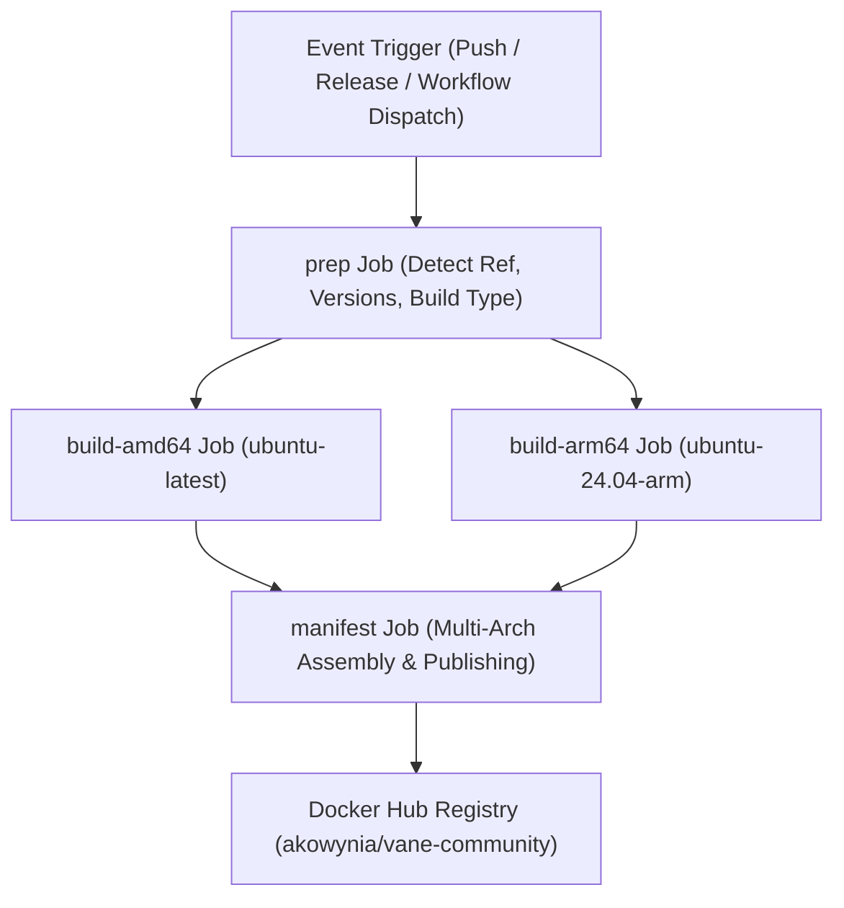

# Docker Multi-Architecture Build & Versioning Pipeline

## 1. Overview and Purpose

The Docker build and release pipeline automates building, packaging, and publishing multi-architecture Docker images to Docker Hub for both modern updates and legacy versions. The architecture allows operators and community users to pull immutable, version-pinned images or track rolling branches (`latest`, `canary`, `main`).

---

## 2. Key Capabilities & Workflow

1. **Automated Multi-Architecture Builds**:
   - Compiles native `linux/amd64` and `linux/arm64` binary images using specialized runners.
   - Combines architecture-specific layers into unified multi-arch Docker manifests.
   - Eliminates slow QEMU emulation overhead by utilizing native CPU architectures.

2. **Dual Distribution Variants**:
   - **Full Variant (`full`)**: Includes all integrated services and embedded components. Tagged both with `full-` prefix and as top-level default images.
   - **Slim Variant (`slim`)**: Lightweight standalone container for decoupled setups using external search or microservice providers. Tagged with `slim-` prefix.

3. **Continuous Versioning & Tag Immutability**:
   - Triggers automatically upon Git tag creation (e.g., `v*`, `vane-community-*`) or published releases.
   - Automatically sanitizes versions and creates dual semantic tags:
     - Version with `v` prefix: `v1.2.0`, `full-v1.2.0`, `slim-v1.2.0`.
     - Raw SemVer without prefix: `1.2.0`, `full-1.2.0`, `slim-1.2.0`.
   - Protects rolling tags (`latest`, `slim-latest`) by preventing non-stable prereleases (`-rc`, `-beta`, `-alpha`) from overwriting production pointers.

4. **On-Demand Backfill for Past & Custom Versions**:
   - Manual workflow dispatch accepts custom Git references (`git_ref`), enabling on-demand compilation of any past commit, tag, or maintenance branch.
   - Optional version tag overrides (`release_version`) and safety toggles (`publish_latest`) prevent accidental rollbacks of the primary `latest` tag when building historical releases.

---

## 3. Workflow Stages & Execution Flow

1. **Preparation Phase (`prep`)**:
   - Evaluates the triggering event, input parameters, and Git reference.
   - Resolves target checkout ref, build type (`release`, `canary`, or `master`), semantic version numbers, and tag identifiers.

2. **Parallel Native Build Phase (`build-amd64` & `build-arm64`)**:
   - Checks out source code at the requested reference.
   - Builds both `full` (`Dockerfile`) and `slim` (`Dockerfile.slim`) variants.
   - Publishes intermediate architecture-tagged images.

3. **Manifest Creation & Aggregation (`manifest`)**:
   - Inspects target variants and pulls architecture-specific images.
   - Creates and publishes multi-architecture manifests linking AMD64 and ARM64 images.
   - Applies semantic version tags and conditionally updates rolling tags (`latest`, `main`).

---

## 4. Tagging Convention Matrix

| Source Event / Ref | Docker Hub Tags Published (Full) | Docker Hub Tags Published (Slim) | Updates `latest`? |
| :--- | :--- | :--- | :--- |
| `push` to `master` | `latest`, `main` | `slim-latest` | Yes |
| `push` to `canary` | `canary` | `slim-canary` | No |
| Release / Tag `v1.2.0` | `1.2.0`, `v1.2.0`, `full-1.2.0`, `full-v1.2.0`, `latest`, `main` | `slim-1.2.0`, `slim-v1.2.0`, `slim-latest` | Yes (if stable) |
| Prerelease `v1.2.0-rc1` | `1.2.0-rc1`, `v1.2.0-rc1`, `full-1.2.0-rc1` | `slim-1.2.0-rc1`, `slim-v1.2.0-rc1` | No |
| Manual Dispatch (`v1.0.0`) | `1.0.0`, `v1.0.0`, `full-1.0.0`, `full-v1.0.0` | `slim-1.0.0`, `slim-v1.0.0` | Configurable (Default: No) |

---

## 5. Manual Build & Backfill Procedure

To build or backfill any specific older or newer version:

1. Navigate to the GitHub repository actions interface.
2. Select the **Build & Push Docker Images** workflow (`docker-build.yaml`).
3. Click **Run workflow**:
   - **`git_ref`**: Provide the exact Git tag (e.g., `v1.0.0`), branch, or commit SHA.
   - **`release_version`**: (Optional) Specify a custom Docker tag if different from the Git ref.
   - **`publish_latest`**: Leave unchecked when building historical versions; check only when intentionally setting the primary `latest` pointer.
4. Execute the workflow to compile and deploy the target images.

