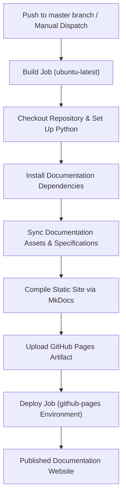

# GitHub Pages Continuous Documentation Deployment

## 1. Overview and Purpose

The GitHub Pages deployment pipeline provides automated continuous integration and publishing for the official project documentation. Whenever code and architectural changes land on the production branch (`master`), GitHub Actions triggers a documentation build and publishes an updated static site to GitHub Pages.

This ensures all features, architectural specifications, configuration guides, and API documentation are instantly accessible to developers, self-hosters, and the open-source community.

---

## 2. Architecture & Technology Stack

The documentation platform utilizes a high-performance static site generation architecture:

1. **Static Site Engine (Material for MkDocs)**:
   - Modern, responsive documentation theme with light and dark mode toggles.
   - Instant search with term highlighting and suggestion previews.
   - Built-in syntax highlighting and one-click code copying.
   - Native Mermaid diagram rendering for architecture graphs and sequence flows.
   - Admonitions, collapsible details, and multi-tab code snippets.

2. **GitHub Actions Native Pages Pipeline**:
   - Uses OpenID Connect (OIDC) authentication and modern GitHub Pages deployment actions (`upload-pages-artifact` and `deploy-pages`).
   - Runs in isolated virtual environments with zero long-term credentials or external tokens required.
   - Concurrency controls prevent race conditions and ensure production deployments finish reliably.

---

## 3. Workflow Stages & Execution Flow

1. **Trigger Phase**:
   - Watches for push events on the `master` branch.
   - Supports manual execution (`workflow_dispatch`) for testing or on-demand redeployment.

2. **Build Phase**:
   - Checks out the latest codebase with complete Git commit history.
   - Configures a Python runtime environment with package caching enabled.
   - Installs documentation generator dependencies.
   - Compiles markdown specifications and architecture documentation into an optimized static distribution directory.
   - Packages and uploads the resulting static site artifact to GitHub Pages storage.

3. **Deployment Phase**:
   - Targets the official `github-pages` deployment environment.
   - Atomically deploys the verified build artifact to the live GitHub Pages hosting infrastructure.

---

## 4. Documentation Structure & Content Hierarchy

The documentation is organized into clear functional areas:

- **Overview & Getting Started**: Introductions, quickstart guides, environment setups, and updating procedures.
- **Engine & Search Architecture**: Deep research workflows, batch search processing, search scrapers, query resilience, and search engine integration.
- **Model Ecosystem & Scheduling**: Provider task queues, model-aware scheduling, response metadata, and telemetry.
- **Workspaces & Capabilities**: Waypoint spaces, recurring crons, webhook triggers, Scratchpad canvas, and slide presentations.
- **Security & Multi-User Governance**: Role-based access control, encrypted credential vaults, SSRF defenses, and API playground.
- **DevOps & Release Pipeline**: Multi-architecture Docker builds, versioning rules, and GitHub Pages deployment.
- **API Reference**: Detailed endpoint documentation and query specifications.

---

## 5. Local Development and Verification

Developers can verify documentation changes locally before submitting Pull Requests:

- Run the documentation server locally using the Python package runner (`uv run --with mkdocs-material mkdocs serve`).
- Build and validate all navigation links and markup integrity (`uv run --with mkdocs-material mkdocs build --strict`).

