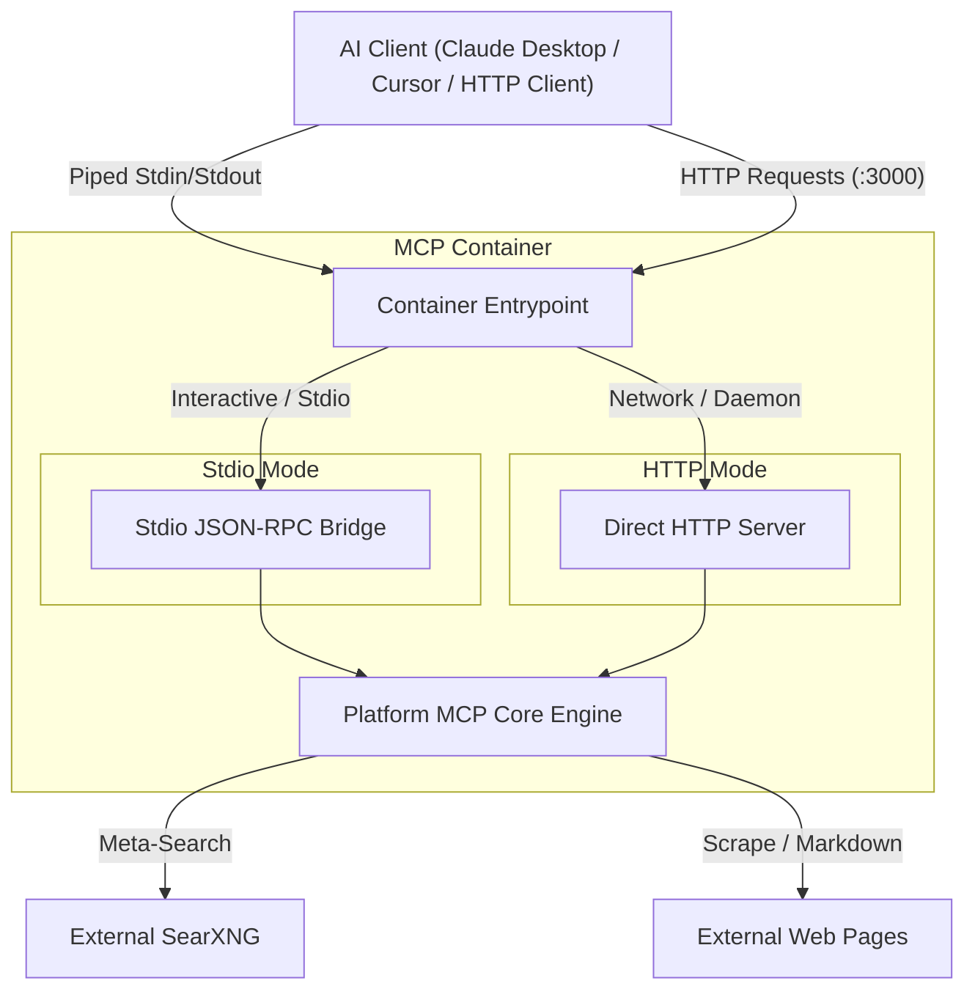

# Standalone MCP Docker Container Architecture

## 1. Overview and Purpose

The dedicated Model Context Protocol (MCP) Docker image packages the platform's search and scraping engine into a standalone, lightweight container. It enables external AI clients such as Claude Desktop, Cursor, or containerized AI orchestrators to directly consume the platform's capabilities without running the entire web application interface.

Published to Docker Hub under:
- `akowynia/vane-community:mcp-latest`
- `akowynia/vane-community:mcp`
- Multi-arch manifests: `linux/amd64` and `linux/arm64`

---

## 2. Dual Transport Architecture

The container supports both communication mechanisms specified by the Model Context Protocol:

### Stdio Transport Mode
- Used by local desktop applications (e.g., Claude Desktop, Cursor) when starting the container via `docker run -i --rm`.
- The entrypoint script detects non-TTY standard input and automatically initializes the background service.
- The standard input/output bridge intercepts newline-delimited JSON-RPC messages and forwards them to the internal engine, returning formatted JSON-RPC responses to standard output.
- All non-protocol logs are isolated to standard error or suppressed, ensuring a clean communication channel.

### HTTP / SSE Transport Mode
- Used when running as a persistent daemon or in Kubernetes / Docker Compose networks via port publishing (e.g., `-p 3000:3000`).
- Serves endpoints:
  - Discovery manifest: `GET /api/mcp` and `GET /mcp`
  - JSON-RPC handler: `POST /api/mcp` and `POST /mcp`

---

## 3. Exposed MCP Tools

The standalone container exposes three primary tools:

1. **`search_web`**:
   - Executes anonymous meta-searches across external SearXNG engines.
   - Parameters:
     - `query` (string, required): Search query.
     - `sources` (array): Filter categories (`web`, `academic`, `discussions`).
     - `limit` (number): Maximum number of results.

2. **`scrape_page`**:
   - Fetches and parses target URLs into clean Markdown.
   - Enforces SSRF defense-in-depth, blocking requests targeting private networks and cloud metadata IP ranges.

3. **`deep_research`**:
   - Orchestrates multi-query and multi-source synthesis with citations.

---

## 4. Configuration and Environment Variables

| Variable | Description | Default |
|---|---|---|
| `SEARXNG_API_URL` | URL of the upstream SearXNG meta-search instance | `http://127.0.0.1:8080` |
| `MCP_TRANSPORT` | Force transport mode (`stdio`, `http`, or `auto`) | `auto` |
| `PORT` | HTTP port when running in network mode | `3000` |
| `MCP_API_KEY` | Optional authorization key for secured endpoints | None |

---

## 5. Automated Build & Release Pipeline

The container is integrated into the automated GitHub Actions CI/CD workflow:
- **Build Matrix**: Builds parallel images for `linux/amd64` and `linux/arm64`.
- **Manifest Creation**: Combines architecture-specific builds into unified multi-arch manifests.
- **Automated Tagging**: Generates `mcp-latest`, `mcp`, `mcp-canary`, and versioned release tags on every publish event.
