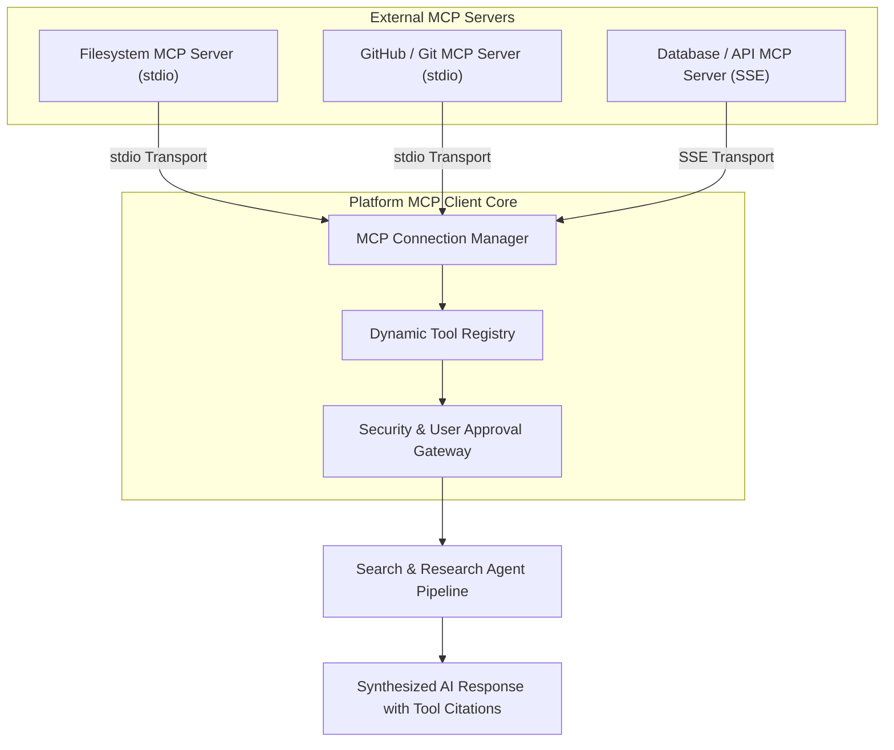
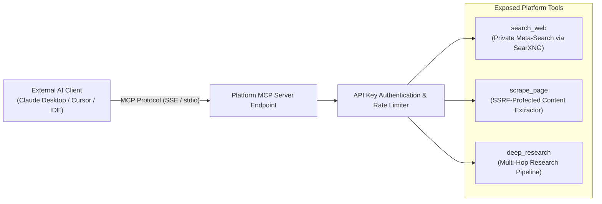

# Model Context Protocol (MCP) Integration Architecture

## 1. Overview and Purpose

The **Model Context Protocol (MCP) Integration** aligns the platform with the open industry standard for connecting AI assistants to external tools, databases, and contextual environments.

The architecture provides comprehensive **bi-directional** MCP support:
1. **Platform as MCP Client**: Connects to third-party MCP servers (local filesystems, GitHub, PostgreSQL, Docker, Home Assistant, custom enterprise APIs), allowing the research agent to discover and invoke external tools dynamically during chat and research sessions.
2. **Platform as MCP Server**: Exposes the platform's private meta-search engine, web scraper, and deep research pipelines as standard MCP tools to external clients such as Claude Desktop, Cursor, and other AI IDEs.

---

## 2. Platform as MCP Client

### Key Client Capabilities:
1. **Dual Transport Protocols**:
   - **stdio Transport**: Spawns and manages local process-based MCP servers with strict execution sandboxing and lifecycle monitoring.
   - **Server-Sent Events (SSE) Transport**: Connects to remote or containerized MCP servers over secure HTTP/HTTPS streams.

2. **Dynamic Tool Discovery & Registration**:
   - Automatically queries connected MCP servers upon startup and configuration change.
   - Discovered tools, input schemas, and resource templates are registered dynamically into the core research tool catalog without requiring platform restarts.

3. **User Approval & Permission Controls**:
   - Configurable execution modes per server: *Always Allow*, *Ask for Approval*, or *Read-Only*.
   - Interactive UI prompt requesting user confirmation before executing tools that perform side effects (such as file writes or database updates).

4. **Telemetry & Execution Diagnostics**:
   - Comprehensive logging of tool invocation parameters, execution latency, and return status within the model telemetry dashboard.

---

## 3. Platform as MCP Server

The platform exposes its privacy-focused search and scraping capabilities as a standards-compliant MCP server, turning any external AI assistant into a privacy-first research powerhouse.

### Exposed Server Tools:
1. **`search_web`**:
   - Executes anonymous queries across configured search engines.
   - Supports source filtering (Web, Academic, Discussions), time range restrictions, and domain constraints.
   - Returns structured snippets, metadata, and citation links.

2. **`scrape_page`**:
   - Fetches and parses target web pages into clean, readable Markdown.
   - Enforces full SSRF protection, preventing unauthorized access to internal services and cloud metadata endpoints.

3. **`deep_research`**:
   - Runs multi-hop autonomous exploration on a given topic.
   - Returns comprehensive multi-source synthesis, key findings, and bibliography.

---

## 4. Security Architecture

1. **Subprocess Isolation**:
   - Local `stdio` processes are executed with restricted environment variables, preventing exposure of platform system secrets.
   - Automatic termination of orphaned or unresponsive subprocesses.

2. **Network & SSRF Guarding**:
   - All remote SSE server connections are routed through the central SSRF inspection guard to prevent access to private IP ranges.

3. **Authentication & Access Control**:
   - External access to the platform's MCP Server requires a valid scoped API key verified with constant-time cryptographic comparison.
   - User roles govern permissions for adding, configuring, and executing MCP servers.

---

## 5. Multi-language Localization

The MCP management interface—including server catalogs, transport configuration wizards, tool permission prompts, and telemetry views—is fully translated across all 12 supported platform languages (`en`, `pl`, `de`, `es`, `fr`, `it`, `pt`, `ru`, `uk`, `zh`, `ja`, `ko`).

---

## 6. Activity Logging, Audit Trail & Usage Analytics

To provide transparency, security monitoring, and usage tracking across both inbound and outbound MCP operations, a specialized activity logging subsystem records every invocation.

### Key Tracking Dimensions:
1. **Directionality**:
   - **Inbound**: Invocations of the platform's exposed tools (`search_web`, `scrape_page`, `deep_research`) by external AI clients (Claude Desktop, Cursor, API integrations).
   - **Outbound**: Invocations of third-party MCP server tools by the platform's autonomous search and research agents.

2. **Caller Identity & Context**:
   - Identified user account, session user, or API key name used for authentication.
   - Client network IP address and User-Agent signature identifying client applications.

3. **Tool Execution Metrics**:
   - Tool name, method (`tools/call`, `tools/list`, `initialize`), and target server.
   - Input payload and sanitized arguments.
   - Result summary or error message.
   - Execution latency in milliseconds.
   - Status categorization (`success` vs `error`).

4. **Aggregate Usage Analytics**:
   - Total volume and real-time success rate.
   - Average execution latency breakdown.
   - Top active callers and most frequently utilized tools.
   - Interactive filtering by direction, status, and full-text search.

