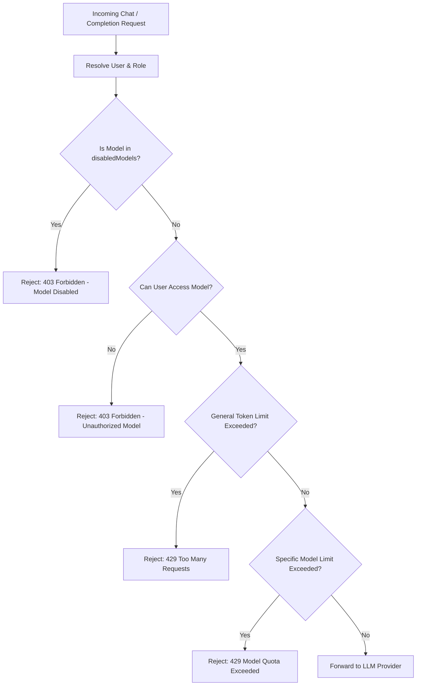

# Model Access Control and Per-Model Quotas

## Overview

In AI chat and agent platforms, administrators need precise governance over LLM models. Previously, any model provided by a configured LLM provider was unconditionally accessible to all users. When administrators wanted to disable expensive, experimental, or deprecated models, or wanted to impose granular per-model token consumption caps, there was no fine-grained mechanism to achieve this.

The Model Access Control and Per-Model Quotas system introduces two levels of governance:
1. **Instance-wide Global Deactivation**: Completely disable specific models across the entire instance. Disabled models are purged from provider lists, hidden from chat model pickers, and rejected at the API boundary.
2. **Per-User Model Access & Quotas**: Enable or block specific models per user account or guest session, and configure rolling token limits (e.g. 5-hour window and daily window) targeted strictly at specific model keys.

---

## Architectural Pillars

### 1. Global Model Deactivation
The global system configuration supports an explicit list of deactivated model keys (`disabledModels`). 
When a model key is included in this list:
- The provider listing API filters it out from available chat models and embedding models.
- The authorization engine immediately rejects any request targeting this model with an authorization error.
- The deactivation applies universally across all users, preventing accidental token spend on high-cost models.

### 2. Per-User Model Permissions
In multi-user mode, each user record maintains an allowlist of accessible models and providers. 
When granular permissions are configured:
- If a user has an explicit allowed models list, only models present in that list can be invoked.
- If a user has an explicit allowed providers list, only models belonging to those providers can be invoked.
- Administrator accounts retain unrestricted access to all active models.

### 3. Per-Model Token Budgets (Quotas)
In addition to general user token limits, the system provides per-model token limits (`modelLimits`). This maps individual model keys to dedicated quota thresholds:
- `tokenLimit5h`: Rolling consumption ceiling over the past 5 hours for this specific model.
- `tokenLimitPerDay`: Rolling consumption ceiling over the past 24 hours for this specific model.
- `tokenLimitWeekly`: Rolling consumption ceiling over the past 7 days for this specific model.

Token usage is evaluated dynamically against recorded model statistics by matching the exact model identifier. When a user exceeds the allocated quota for a specific model:
- The request is halted with a rate-limit error detailing the exceeded window.
- The user is prevented from invoking that specific model until the rolling window clears.
- The user may still use other permitted models if their general or model-specific quotas are intact.

---

## Data Model and Persistence

### User Records
The user entity includes a dedicated attribute:
- `model_limits`: A JSON string storing a key-value dictionary where each key is a canonical model identifier (e.g., `openai:gpt-4o`, `anthropic:claude-3-5-sonnet`) and the value is an object defining quota numbers (`tokenLimit5h`, `tokenLimitPerDay`, `tokenLimitWeekly`).
- Auto-migration ensures existing databases receive the new column without manual intervention.

### Global Configuration
The persistent system configuration includes:
- `disabledModels`: An array of disabled canonical model keys.
- `globalLimits.modelLimits`: Default per-model limits applicable to guest sessions or default user tiers.

---

## Security & Enforcement Workflow

The security verification follows a defense-in-depth sequence on every model-dependent request:

### Defense-in-Depth Steps:
1. **Global Exclusion**: If the requested model is globally disabled, execution terminates immediately. Even administrators cannot run globally disabled models without first re-enabling them in settings.
2. **Identity & Role Verification**: Non-admin users are checked against their specific allowed models list and allowed providers list.
3. **General Token Evaluation**: The user's overall token consumption is checked against global and user-level 5-hour and 7-day ceilings.
4. **Model-Specific Token Evaluation**: Consumption records for the exact model key are queried from the statistics storage across the rolling 5-hour and daily windows. If usage meets or exceeds the defined threshold, execution halts with a detailed limit notice.

---

## User Interface & Administration

The Access Control interface in settings provides a unified control center for model permissions:
- **Scope Selector**: Seamlessly switch between "All Users (Instance-wide)" and "Per-User Permissions".
- **Instance-wide View**: Allows toggling any configured model between `Active` and `Disabled`. Quick actions allow enabling or disabling all models for a given provider simultaneously.
- **Per-User View**: Select any registered user to inspect and modify their allowed providers, allowed models, and custom token quotas.
- **Collapsible Quota Panels**: Each model row features an expandable quota editor allowing numeric input for 5-hour and daily token limits, with instant visual indicators for active limits.

