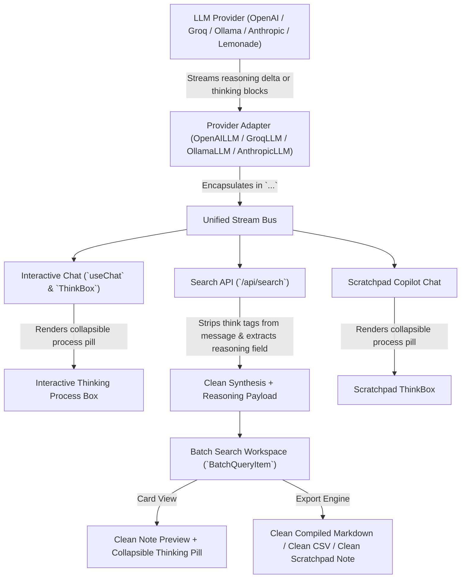

# Model Reasoning and Thinking Process Isolation Architecture

## 1. Overview and Purpose

Modern reasoning models (such as DeepSeek-R1, QwQ-32b, OpenAI o1/o3, and Claude models with Extended Thinking) generate internal step-by-step thinking processes (Chain-of-Thought / CoT) prior to synthesizing their final answer.

Depending on the inference engine, API provider, and transport protocol, these internal thoughts may be delivered through:
- Specialized SSE delta fields (e.g. `reasoning_content`, `reasoning`, `thinking`, or `thinking_delta`),
- Explicit markdown delimiter tags (e.g. `<think>...</think>`, `<thought>...</thought>`, `<thinking>...</thinking>`),
- Native model token streams.

Without systematic encapsulation and isolation, internal reasoning tokens risk bleeding into synthesized end-user content, polluting compiled research documents, corrupting CSV exports, and degrading the user experience.

This document describes the unified architecture for capturing, encapsulating, normalizing, and isolating model reasoning across all providers, interactive chat interfaces, batch processing workflows, and programmatic APIs.

---

## 2. Core Principles & Architecture

---

## 3. Provider-Level Encapsulation

Every provider implementation guarantees that internal reasoning is never emitted as unadorned body text:

1. **OpenAI & OpenAI-Compatible (`OpenAILLM`)**:
   - Covers OpenAI (`o1`, `o3-mini`), Lemonade AMD AI Server, LM Studio, Ollama Cloud, and custom endpoints.
   - During streaming (`streamText`), when incoming chunks contain `reasoning_content`, `reasoning`, or `thinking`, an open delimiter `<think>\n` is emitted automatically on the initial chunk.
   - When the model switches from reasoning to primary content (`delta.content`), the closing delimiter `\n</think>\n\n` is injected before the first content token.
   - If a stream terminates prematurely during the reasoning phase, the closing tag is emitted to preserve structural document integrity.
   - In non-streaming mode (`generateText`), reasoning and content are cleanly unified into `<think>\n{reasoning}\n</think>\n\n{content}`.

2. **Groq (`GroqLLM`)**:
   - Manages fast inference for DeepSeek R1 Distill and QwQ models.
   - Encapsulates `delta.reasoning_content` with identical state-machine boundaries as `OpenAILLM`.

3. **Ollama (`OllamaLLM`)**:
   - Streams native `chunk.message.thinking` inside `<think>...</think>` tags and transitions smoothly into `chunk.message.content`.
   - In non-streaming mode, wraps `res.message.thinking` when present.

4. **Anthropic (`AnthropicLLM`)**:
   - Captures SSE `thinking_delta` events for Claude extended thinking, buffering and outputting them encapsulated in `<think>...</think>`.

---

## 4. Normalization Across Alternative Tags

Different model families use alternative naming conventions. The frontend and utility layers automatically normalize all variations to canonical `<think>`:
- `<thought>...</thought>` → `<think>...</think>`
- `<thinking>...</thinking>` → `<think>...</think>`

This normalization is applied across:
- Interactive chat block processing,
- Markdown-to-print and PDF conversion utilities,
- JSON sanitization and repair parsers,
- Navigation text cleaners and clipboard exports.

---

## 5. Batch Search & Research Studio Isolation

Batch Search runs high-throughput conceptual queries for bulk document compilation. Research notes must remain authoritative, concise, and free from internal reasoning artifacts:

1. **Dual Separation in API Responses**:
   - The search endpoint separates the raw response into a clean `message` (with thinking tags completely removed) and an optional `reasoning` payload.
2. **Note Card UI**:
   - The note content card displays only the polished synthesis.
   - If the model provided reasoning, an expandable pill with a brain icon is rendered, allowing researchers to inspect the model's intermediate logic on demand without cluttering the note.
3. **Document & CSV Export Integrity**:
   - The compilation compiler, plain text formatter, CSV exporter, and Scratchpad transfer functions sanitize all notes defensively, guaranteeing that exported research publications contain zero internal reasoning noise.

---

## 6. Defensive Engineering & Security

- **Anti-ReDoS Sanitation**: All delimiter matching uses non-greedy expressions without catastrophic backtracking vulnerabilities.
- **Safety Against Prompt Injection**: Separating internal reasoning from user-facing notes prevents injected reasoning patterns from being displayed as synthesized findings.
- **Malformed Tag Tolerance**: If a model emits unmatched tags (e.g. an unclosed opening tag due to context truncation), parsers automatically balance the tags to avoid breaking surrounding HTML/Markdown layouts.

