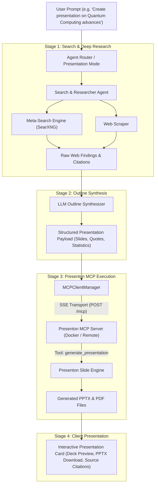

# Architecture Concept: Presenton MCP Integration & Research-to-Presentation Pipeline

## 1. Overview and Purpose

This document outlines the architectural design for integrating **Presenton** as an external Model Context Protocol (MCP) server within the platform, combined with an autonomous **Research-to-Presentation** pipeline.

The goal is to allow users to request high-quality, fully editable presentation slide decks (`.pptx` and `.pdf`) generated directly from live web search and deep research. The system operates in a staged execution pattern:
1. **Autonomous Web Research Phase**: Queries are executed via the search agent, gathering citations, statistics, facts, and structure.
2. **Data Structuring & Synthesis Phase**: Research findings are distilled into a grounded, comprehensive slide deck outline.
3. **MCP Presentation Generation Phase**: The structured data is transmitted to Presenton's MCP server via tool invocation (`generate_presentation`), returning a downloadable and editable presentation.

This capability is exposed as a distinct **Beta Feature** under the laboratory settings.

---

## 2. Presenton MCP Integration Architecture

Presenton natively exposes a Model Context Protocol server over HTTP with Server-Sent Events (SSE) or Streamable HTTP. The platform communicates with Presenton using the existing `MCPClientManager`.



---

## 3. Communication and MCP Transport Configuration

### 3.1. Connection Details
- **Transport Type**: `sse` (Streamable HTTP / SSE)
- **Default Endpoint**: `http://presenton/mcp` (or host alias `http://localhost:5001/mcp`)
- **Authentication**: Optional Bearer token / API key header via `Authorization: Bearer <API_KEY>`
- **Exposed Tools**:
  - `start_standard_presentation` / `start_smart_presentation`: Primary tools accepting parameters:
    - `content`: In-depth textual brief containing synthesized research, slide titles, bullet points, and source citations.
    - `n_slides`: Target number of slides (e.g. 5, 8, 10, 12).
    - `export_as`: Export format (`pptx` or `pdf`).
    - `language`: Output language code matching the user's active locale.
  - `get_job_status`: Poll async task progress until status is completed.

### 3.2. Preset Registration in MCP Settings
To ensure simple configuration, a preset is registered in `MCP.tsx`:
- **Preset Identifier**: `presenton`
- **Name**: Presenton Presentation Server
- **Transport**: `sse`
- **URL**: `http://presenton/mcp`
- **Auto-Approve**: Enabled by default for slide generation commands

---

## 4. Staged Execution Workflow (Research-to-Deck)

### 4.1. Step 1: Research Execution
When the user submits a prompt in Presentation Research mode:
- The system generates 3 to 6 targeted search queries across configured web sources.
- The `Researcher` agent gathers factual snippets, key quantitative figures, and authoritative publication references.
- Results are filtered to remove promotional noise and verified against hallucinations.

### 4.2. Step 2: Payload Structuring
Rather than sending a raw, unverified prompt to the presentation tool, the LLM constructs an evidence-backed presentation brief:
- **Title & Executive Summary**
- **Slide-by-Slide Blueprint**:
  - Slide header and narrative purpose.
  - Core takeaways grounded in retrieved sources.
  - Supporting numbers, percentages, and benchmark data.
  - Bibliography references with verifiable domain names.

### 4.3. Step 3: MCP Tool Call
The platform dispatches an execution request through `MCPClientManager.callTool`:
- Server: `presenton`
- Tool: `generate_presentation`
- Arguments:
  ```json
  {
    "prompt": "Synthesized slide deck outline with structured research findings...",
    "n_slides": 8,
    "language": "en"
  }
  ```

### 4.4. Step 4: UI Presentation & Artifact Handling
Upon completion:
- The UI renders an interactive presentation card in the chat stream or Scratchpad.
- Users receive direct download links for the `.pptx` (PowerPoint) and `.pdf` files.
- An interactive bibliography panel allows verifying every claim made on the slides against original web citations.

---

## 5. Beta Option and Feature Flag Architecture

The feature is protected under the **Beta Options** system to ensure stability and clean separation of concerns.

### 5.1. Feature Flag Definition
- **Key**: `enablePresentonBeta`
- **Scope**: `client`
- **Default**: `false`
- **Settings Category**: `Beta.tsx` (Laboratory Features)

### 5.2. UI Touchpoints
1. **Settings > Beta Options**:
   - A dedicated toggle for "Presenton AI Presentations (MCP)".
   - Description highlighting live web research and direct `.pptx` generation.
2. **Message Input & Optimization Selector (`Optimization.tsx`)**:
   - When the beta flag is active, an additional mode ("Presentation Mode") appears in the mode dropdown.
3. **Scratchpad Workspace (`CreatePresentationDialog.tsx`)**:
   - Presentation generator modal offers an engine selection:
     - Built-in Vane Canvas Engine (interactive React canvas).
     - Presenton MCP Engine (native PowerPoint export via connected MCP).

---

## 6. Docker Container Deployment

For self-hosted environments using `docker-compose.yaml`, Presenton can be run as an optional service using Docker profiles:

```yaml
services:
  presenton:
    image: ghcr.io/presenton/presenton:latest
    container_name: vane-presenton
    ports:
      - "5001:80"
    volumes:
      - presenton-data:/app_data
    environment:
      - CAN_CHANGE_KEYS=true
      - PRESENTATION_GENERATION_MODE=both
      - DISABLE_AUTH=true
      - LLM=${PRESENTON_LLM:-openai}
    restart: unless-stopped
    profiles:
      - presentations
      - presenton

volumes:
  presenton-data:
    name: vane-presenton-data
```

To run with Presenton enabled:
```bash
docker compose --profile presenton up -d
```

---

## 7. Multi-language Localization (i18n)

All interface strings, tooltips, beta descriptions, and presentation options are localized across all 12 supported platform languages:

```json
{
  "en": {
    "betaPresentonTitle": "Presenton Presentations (MCP)",
    "betaPresentonDesc": "Generate editable PowerPoint and PDF decks via Presenton MCP using deep web research.",
    "presentonModeTitle": "Presentation",
    "presentonModeDesc": "Researches the topic online and generates an editable slide deck via Presenton MCP.",
    "presentonGenerating": "Conducting research and generating presentation slides...",
    "presentonDownloadPptx": "Download PowerPoint (.pptx)",
    "presentonDownloadPdf": "Download PDF",
    "presentonPresetName": "Presenton Presentation Generator (SSE)"
  },
  "pl": {
    "betaPresentonTitle": "Prezentacje Presenton (MCP)",
    "betaPresentonDesc": "Generuj edytowalne prezentacje PowerPoint i PDF przez Presenton MCP w oparciu o research w sieci.",
    "presentonModeTitle": "Prezentacja",
    "presentonModeDesc": "Bada temat w sieci i tworzy edytowalną prezentację slajdów za pośrednictwem Presenton MCP.",
    "presentonGenerating": "Przeprowadzanie researchu i generowanie slajdów prezentacji...",
    "presentonDownloadPptx": "Pobierz PowerPoint (.pptx)",
    "presentonDownloadPdf": "Pobierz PDF",
    "presentonPresetName": "Generator prezentacji Presenton (SSE)"
  },
  "de": {
    "betaPresentonTitle": "Presenton-Präsentationen (MCP)",
    "betaPresentonDesc": "Erstellen Sie bearbeitbare PowerPoint- und PDF-Folien über Presenton MCP auf Basis von Webrecherchen.",
    "presentonModeTitle": "Präsentation",
    "presentonModeDesc": "Recherchiert das Thema im Web und erstellt eine Präsentation über Presenton MCP.",
    "presentonGenerating": "Recherche läuft und Präsentationsfolien werden generiert...",
    "presentonDownloadPptx": "PowerPoint herunterladen (.pptx)",
    "presentonDownloadPdf": "PDF herunterladen",
    "presentonPresetName": "Presenton Präsentationsgenerator (SSE)"
  },
  "es": {
    "betaPresentonTitle": "Presentaciones Presenton (MCP)",
    "betaPresentonDesc": "Genera presentaciones editables en PowerPoint y PDF a través de Presenton MCP basadas en investigación web.",
    "presentonModeTitle": "Presentación",
    "presentonModeDesc": "Investiga el tema en la web y crea una presentación mediante Presenton MCP.",
    "presentonGenerating": "Realizando investigación y generando diapositivas...",
    "presentonDownloadPptx": "Descargar PowerPoint (.pptx)",
    "presentonDownloadPdf": "Descargar PDF",
    "presentonPresetName": "Generador de presentaciones Presenton (SSE)"
  },
  "fr": {
    "betaPresentonTitle": "Présentations Presenton (MCP)",
    "betaPresentonDesc": "Générez des présentations éditables PowerPoint et PDF via Presenton MCP à partir de recherches web.",
    "presentonModeTitle": "Présentation",
    "presentonModeDesc": "Recherche le sujet sur le web et génère des diapositives via Presenton MCP.",
    "presentonGenerating": "Recherche en cours et génération de la présentation...",
    "presentonDownloadPptx": "Télécharger PowerPoint (.pptx)",
    "presentonDownloadPdf": "Télécharger PDF",
    "presentonPresetName": "Générateur de présentations Presenton (SSE)"
  },
  "it": {
    "betaPresentonTitle": "Presentazioni Presenton (MCP)",
    "betaPresentonDesc": "Genera presentazioni modificabili PowerPoint e PDF tramite Presenton MCP basate su ricerche web.",
    "presentonModeTitle": "Presentazione",
    "presentonModeDesc": "Ricerca il tema sul web e crea diapositive tramite Presenton MCP.",
    "presentonGenerating": "Ricerca in corso e generazione delle diapositive...",
    "presentonDownloadPptx": "Scarica PowerPoint (.pptx)",
    "presentonDownloadPdf": "Scarica PDF",
    "presentonPresetName": "Generatore di presentazioni Presenton (SSE)"
  },
  "pt": {
    "betaPresentonTitle": "Apresentações Presenton (MCP)",
    "betaPresentonDesc": "Gere apresentações editáveis em PowerPoint e PDF via Presenton MCP com base em pesquisas na web.",
    "presentonModeTitle": "Apresentação",
    "presentonModeDesc": "Pesquisa o tema na web e cria slides editáveis através do Presenton MCP.",
    "presentonGenerating": "Realizando pesquisa e gerando slides da apresentação...",
    "presentonDownloadPptx": "Baixar PowerPoint (.pptx)",
    "presentonDownloadPdf": "Baixar PDF",
    "presentonPresetName": "Gerador de apresentações Presenton (SSE)"
  },
  "ru": {
    "betaPresentonTitle": "Презентации Presenton (MCP)",
    "betaPresentonDesc": "Создавайте редактируемые презентации PowerPoint и PDF через Presenton MCP на основе веб-исследований.",
    "presentonModeTitle": "Презентация",
    "presentonModeDesc": "Исследует тему в интернете и создает презентацию через Presenton MCP.",
    "presentonGenerating": "Выполняется поиск и генерация слайдов презентации...",
    "presentonDownloadPptx": "Скачать PowerPoint (.pptx)",
    "presentonDownloadPdf": "Скачать PDF",
    "presentonPresetName": "Генератор презентаций Presenton (SSE)"
  },
  "uk": {
    "betaPresentonTitle": "Презентації Presenton (MCP)",
    "betaPresentonDesc": "Створюйте редаговані слайди PowerPoint і PDF через Presenton MCP на основі веб-досліджень.",
    "presentonModeTitle": "Презентація",
    "presentonModeDesc": "Досліджує тему в інтернеті та створює слайди через Presenton MCP.",
    "presentonGenerating": "Виконується пошук і генерація слайдів презентації...",
    "presentonDownloadPptx": "Завантажити PowerPoint (.pptx)",
    "presentonDownloadPdf": "Завантажити PDF",
    "presentonPresetName": "Генератор презентацій Presenton (SSE)"
  },
  "zh": {
    "betaPresentonTitle": "Presenton 演示文稿 (MCP)",
    "betaPresentonDesc": "通过 Presenton MCP 基于深度网络检索生成可编辑的 PowerPoint 和 PDF 幻灯片。",
    "presentonModeTitle": "演示文稿",
    "presentonModeDesc": "在线检索主题并通过 Presenton MCP 生成可编辑的演示幻灯片。",
    "presentonGenerating": "正在检索并生成演示文稿幻灯片...",
    "presentonDownloadPptx": "下载 PowerPoint (.pptx)",
    "presentonDownloadPdf": "下载 PDF",
    "presentonPresetName": "Presenton 演示文稿生成器 (SSE)"
  },
  "ja": {
    "betaPresentonTitle": "Presenton プレゼンテーション (MCP)",
    "betaPresentonDesc": "ウェブ検索調査をもとに Presenton MCP 経由で編集可能な PowerPoint および PDF を生成します。",
    "presentonModeTitle": "プレゼンテーション",
    "presentonModeDesc": "トピックをウェブ検索で調査し、Presenton MCP を介してスライドを作成します。",
    "presentonGenerating": "リサーチを実行しプレゼンテーションスライドを生成中...",
    "presentonDownloadPptx": "PowerPoint をダウンロード (.pptx)",
    "presentonDownloadPdf": "PDF をダウンロード",
    "presentonPresetName": "Presenton プレゼンテーションジェネレーター (SSE)"
  },
  "ko": {
    "betaPresentonTitle": "Presenton 프레젠테이션 (MCP)",
    "betaPresentonDesc": "웹 검색 조사를 바탕으로 Presenton MCP를 통해 편집 가능한 PowerPoint 및 PDF 슬라이드를 생성합니다.",
    "presentonModeTitle": "프레젠테이션",
    "presentonModeDesc": "웹에서 주제를 조사하고 Presenton MCP를 통해 프레젠테이션을 생성합니다.",
    "presentonGenerating": "자료 조사 및 프레젠테이션 슬라이드 생성 중...",
    "presentonDownloadPptx": "PowerPoint 다운로드 (.pptx)",
    "presentonDownloadPdf": "PDF 다운로드",
    "presentonPresetName": "Presenton 프레젠테이션 생성기 (SSE)"
  }
}
```

---

## 8. Summary of Benefits

1. **Native MCP Compliance**: Reuses the platform's robust Model Context Protocol infrastructure without custom proprietary bridges.
2. **Fact-Grounded Slide Decks**: Solves the common problem of hallucinated presentation decks by grounding all content in meta-search queries.
3. **Editable Outputs**: Produces native `.pptx` presentations that users can open, refine, and present in Microsoft PowerPoint, Keynote, or Google Slides.
4. **Isolated Beta Access**: Allows opt-in experimentation without risking existing chat or Scratchpad workflows.

