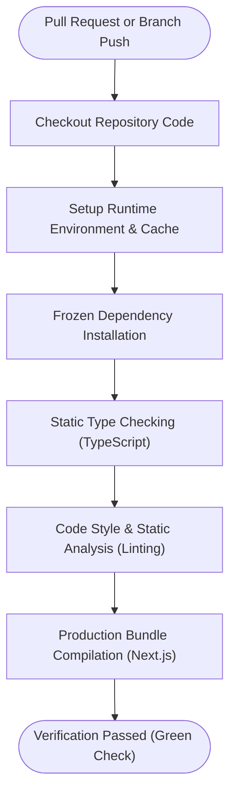

# Continuous Pull Request & Branch Verification Pipeline

## Overview

The automated verification pipeline provides continuous integration checks for incoming pull requests and branch updates before code can be merged into active branches. It ensures that syntax errors, broken imports, type mismatches, and build regressions are caught early and automatically.

---

## Trigger Strategy & Scope

The pipeline is triggered automatically on:
- Any pull request opened or updated against primary development and production branches.
- Direct pushes to the active development branch.

Targeting both primary branches protects against pull requests erroneously directed towards the production branch instead of the standard development branch.

---

## Pipeline Architecture & Verification Stages

The verification pipeline executes in an isolated environment using the current LTS runtime environment matching the containerized deployment specifications.

### 1. Dependency Integrity Verification
Dependencies are installed strictly from locked manifest definitions. Any mismatch between package requirements and committed lockfiles fails immediately, preventing supply-chain discrepancies or incomplete manual dependency updates.

### 2. Static Type & Module Resolution Checking
TypeScript verification runs across all application modules, utility libraries, and route handlers. This stage validates:
- Module import paths and missing module exports.
- Component prop contracts and API request/response typing.
- Security and database schema access signatures.

### 3. Linting & Code Quality Validation
The linter validates framework-specific best practices, React hooks conventions, and Core Web Vitals guidelines.

### 4. Full Production Compilation
Next.js production compilation is executed to ensure:
- Server and client component boundaries compile cleanly.
- Webpack bundler succeeds without missing asset references.
- Dynamic route segment configurations are structurally valid.

---

## Security & Isolation Model

- **Read-Only Permissions:** The verification workflow is configured with minimal read-only repository contents permissions.
- **Untrusted Code Execution Boundary:** Pull request builds from forks run in standard restricted environments without access to repository secrets or deployment credentials.
- **Concurrency Management:** Pushing new commits to an active pull request automatically cancels any in-progress validation runs for that branch, saving computational resources and ensuring status checks reflect the latest commit.

