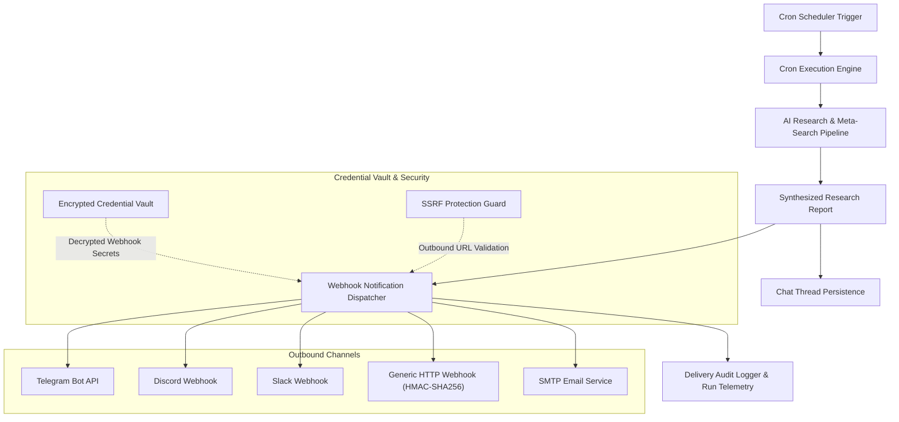

# Waypoint Cron Webhooks & Proactive Notifications Architecture

## 1. Overview and Purpose

The **Waypoint Cron Webhooks & Proactive Notifications** module extends the scheduled research engine by adding automated outbound notification dispatching. 

Previously, background cron jobs executed searches and created chat threads within Waypoint spaces, requiring users to log into the web application to view findings. With outbound notification channels, Waypoint Crons proactively transmit synthesized intelligence digests, news monitoring updates, and research alerts directly to team communication platforms, mobile messengers, and automated workflow pipelines.

---

## 2. Supported Notification Channels

1. **Telegram Bot**:
   - Delivers instant notifications directly to individual users, group chats, or broadcast channels.
   - Messages are formatted using Markdown with inline source citations and navigational links.
   - Configurable Bot Token and Chat ID parameters.

2. **Discord Webhooks**:
   - Posts structured rich embeds into designated Discord channels.
   - Embeds feature dynamic color-coding based on execution status, categorized field blocks for key takeaways, and direct source link references.

3. **Slack Webhooks**:
   - Utilizes Slack Block Kit layouts for clean enterprise formatting.
   - Formats summaries with bold highlights, bullet points, and contextual action buttons.

4. **Generic HTTP Webhooks**:
   - Dispatches standard JSON payloads containing complete research metadata, query settings, source citations, and full text responses.
   - Includes cryptographic HMAC-SHA256 signature headers (`X-Vane-Signature`) for recipient validation.
   - Seamlessly integrates with external automation platforms such as n8n, Make, Zapier, and Home Assistant.

5. **SMTP / Email Delivery**:
   - Sends formatted HTML research briefings to configured email recipients for daily, weekly, or event-driven alerts.

---

## 3. Key Capabilities & Workflow

1. **Per-Cron Channel Binding**:
   - Each Waypoint Cron job can be associated with one or multiple notification channels.
   - Jobs can independently define whether to dispatch on every run, only upon discovering new information, or exclusively on execution errors.

2. **Delivery Content Modes**:
   - **Executive Summary Mode**: Concise high-level takeaways optimized for quick mobile reading.
   - **Full Research Digest Mode**: Complete synthesized text with itemized sections and comprehensive citations.
   - **Raw Structured Payload**: JSON format designed for programmatic downstream processing.

3. **Instant Test Dispatch**:
   - The cron configuration modal provides a dedicated **Test Notification** button.
   - Verifies channel connectivity, secret authorization, and formatting before saving the schedule.

4. **Resilience & Retry Pipeline**:
   - Asynchronous dispatch queue independent of the core search execution loop.
   - Exponential backoff retry strategy for handling temporary network disruptions or third-party rate limits.
   - Comprehensive audit logging recording delivery timestamps, HTTP response codes, and error diagnostics.

---

## 4. Architecture and Data Flow

---

## 5. Security & Vault Integration

1. **Secret Encryption**:
   - All webhook target URLs, bot tokens, and signing secrets are stored encrypted at rest within the platform's AES-256-GCM Credential Vault.
   - Secrets are masked across all client-facing API responses.

2. **SSRF Guard Protection**:
   - All outbound webhook destination endpoints are validated through the central SSRF inspection guard.
   - Restricts loopback addresses, link-local addresses, private network ranges (unless explicitly whitelisted by the administrator), and cloud instance metadata addresses.

3. **Payload Signature Verification**:
   - Outbound HTTP requests can include a SHA-256 HMAC signature generated with a user-defined secret, enabling receiving webhooks to verify payload integrity and authenticity.

---

## 6. Multi-language Localization

All user interface components—including channel setup dialogs, test dispatch feedback, error notifications, delivery badges, and payload templates—are fully localized across all 12 supported platform languages (`en`, `pl`, `de`, `es`, `fr`, `it`, `pt`, `ru`, `uk`, `zh`, `ja`, `ko`).

